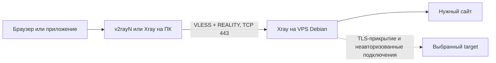

# VLESS + REALITY: сервер Debian и клиенты Windows/Linux

Подробное руководство на русском языке. Документация и релизы проверены **31 октября 2026 года**. Схема: **Xray-core → VLESS → RAW/TCP → REALITY → XTLS Vision**, входящий порт сервера `443/tcp`.

## С чего начать

1. [Подготовить и запустить VPS на Debian](docs/server-debian.md).
2. Сохранить полученную ссылку `vless://…`.
3. Настроить клиент: [Windows](docs/client-windows.md) или [Linux](docs/client-linux.md).
4. Проверить подключение по [инструкции диагностики](docs/troubleshooting.md).

Если сервер уже есть, начните с клиентской инструкции и запросите у администратора параметры из таблицы ниже.

## Что эта схема даёт в условиях России

REALITY защищает соединение клиента с VPS и использует TLS-параметры выбранного настоящего сайта как прикрытие. Трафик выходит в интернет с IP вашего VPS. Владеть доменом прикрытия и выпускать для него сертификат не требуется. Сам VLESS в описанной конфигурации использует `encryption: none`; транспорт шифрует REALITY. См. [описание REALITY](https://github.com/XTLS/REALITY/blob/main/README.en.md) и [VLESS outbound](https://xtls.github.io/en/config/outbounds/vless.html).

**Работоспособность в конкретной сети нужно проверять.** Исследователи описывают разные механизмы ограничений: SNI-фильтрацию, ограничения по подсетям назначения и остановку передачи после небольшого объёма данных. Это наблюдения отдельных сетей, а не обещание одинакового поведения у всех операторов. [Первичное обсуждение измерений net4people](https://github.com/net4people/bbs/issues/490).

Практический вывод: REALITY может помочь при блокировке сайтов и части протоколов, если доступно соединение с VPS. Он не создаёт связь при полном отключении передачи данных и не делает недоступный IP доступным за счёт смены SNI. При разрешении только избранных IP произвольный зарубежный VPS может не подключиться. Для проверки сравнивайте домашнюю сеть и мобильного оператора; резервный узел имеет смысл размещать в другой сети/ASN.

Основной пользовательский трафик после авторизации идёт с VPS к нужному сайту, а не через сайт прикрытия.

## Проверенные версии и совместимость

| Компонент | Что проверено | Ссылка |
|---|---|---|
| Xray-core | `v26.10.31`, текущий Latest на дату проверки | [Официальный релиз](https://github.com/XTLS/Xray-core/releases/tag/v26.10.31) |
| v2rayN | `7.25.6`, текущий Latest на дату проверки | [Официальный релиз](https://github.com/2dust/v2rayN/releases/tag/7.25.6) |
| Debian | Debian 13 `trixie` — текущая stable; команды рассчитаны на Debian 13/12 с systemd | [Релизы Debian](https://www.debian.org/releases/) |

Для воспроизводимости серверная инструкция устанавливает Xray `26.10.31`. При более позднем выполнении сначала прочитайте примечания к новым стабильным релизам. Обновление приложения v2rayN и обновление его ядра Xray — разные действия.

Обновление от 31.10.2026: авторы отозвали ранее указанную версию `26.10.29` при выпуске срочного обновления безопасности `26.10.31`. Старый адрес архива возвращает 404. Устанавливайте новую версию; причина изменения и рекомендация обновить ядро Linux приведены в [официальных примечаниях](https://github.com/XTLS/Xray-core/releases/tag/v26.10.31).

В текущих примерах используются `network: raw`, `target`, `password`, `settings.users` на сервере и плоские `settings.address/port/id` на клиенте. В старых статьях встречаются `tcp`, `dest`, `publicKey`, `clients`, `vnext`. Часть старых имён остаётся совместимыми псевдонимами; преобразовывать вручную импортированную ссылку для этого не требуется. Сверка: [RAW](https://xtls.github.io/en/config/transports/raw.html), [REALITY](https://xtls.github.io/en/config/transports/reality.html), [схема VLESS в версии 26.10.31](https://github.com/XTLS/Xray-core/blob/v26.10.31/infra/conf/vless.go).

В октябре 2026 года также есть сообщения о несовместимости некоторых старых TLS-профилей, например `edge`, с новыми REALITY-серверами; участник команды рекомендует `chrome`. Поэтому здесь начальный профиль — `chrome`, без обещания, что он обойдёт фильтрацию любого оператора. [Обсуждение Xray #7259](https://github.com/XTLS/Xray-core/issues/7259).

## Какие параметры сохранить

| Параметр | Где нужен | Значение |
|---|---|---|
| `SERVER_IP` | Клиент | Публичный IPv4 вашего VPS; не IP сайта прикрытия |
| `443` | Обе стороны | Внешний порт сервера |
| `UUID` | Обе стороны | Индивидуальный идентификатор пользователя |
| `PRIVATE_KEY` | Только сервер | Строка `PrivateKey` команды `xray x25519` |
| `REALITY_PASSWORD` | Клиент | Строка `Password (PublicKey)` той же команды; в ссылке — `pbk` |
| `SHORT_ID` | Обе стороны | В этом руководстве 16 шестнадцатеричных символов |
| `TARGET_SERVER_NAME` | Обе стороны | Настоящее TLS-имя выбранного сайта; SNI клиента |
| `xtls-rprx-vision` | Обе стороны | Режим `flow` |
| `chrome` | Клиент | TLS fingerprint |

`PRIVATE_KEY` не передают клиентам. Ссылку `vless://…`, UUID и клиентский ключ храните как реквизиты доступа. Даже если интерфейс называет ключ «публичным», разработчики REALITY не рекомендуют публиковать клиентский `password` открыто. [Описание полей](https://xtls.github.io/en/config/transports/reality.html).

## Готовые шаблоны

- [Сервер Xray](examples/server-reality.json).
- [Клиент Xray с SOCKS и HTTP на localhost](examples/client-reality.json).

Шаблоны содержат метки `REPLACE_…`. Это **не готовые реквизиты**: перед запуском замените все метки. Смысл каждой замены разобран в инструкциях. Используйте шаблон только на соответствующей стороне: клиентский конфиг не подходит для VPS.

## Как проверить результат

Подключение считается проверенным, когда одновременно:

- серверная служба активна, конфигурация проходит `xray run -test`;
- клиент делает HTTPS-запрос через SOCKS, получает внешний IP VPS;
- через туннель загружаются страницы и заметный объём данных;
- для нужных приложений выбран системный прокси или TUN;
- DNS и IPv6 ведут себя согласно выбранной политике маршрутизации.

Зелёный значок, успешный `ping` или открытый TCP-порт отдельно этого не подтверждают. Самостоятельный VPS также не обеспечивает анонимность перед хостингом или посещаемыми сервисами; HTTPS до конечного сайта по-прежнему нужен.

## Что проверено при подготовке

Оба полных JSON-шаблона после подстановки временных реквизитов приняты официальным Xray `26.10.31` командой `run -test`. Архив ядра сверён с SHA-256 из официального GitHub Releases API.

Дополнительно выполнен реальный HTTPS-запрос к `example.com` через две локальные копии Xray на Windows: клиент → VLESS/REALITY/Vision → сервер → HTTPS. И SOCKS5h, и HTTP CONNECT дали HTTP 200 с ожидаемым содержимым. Для теста входящий адрес сервера был ограничен `127.0.0.1`, порты заменены временными; остальные параметры полных шаблонов, включая маршрутизацию, сохранены. Target — `www.kernel.org`. После проверки процессы остановлены.

Проверены синтаксис Bash- и PowerShell-блоков, JSON-примеры, локальные ссылки и работа генератора URI на временных данных.

Установка пакетов и systemd на настоящем Debian VPS, графический интерфейс v2rayN, TUN и соединение через конкретного российского оператора в этой проверке не испытывались. Для них в руководстве приведены отдельные команды и критерии результата.
